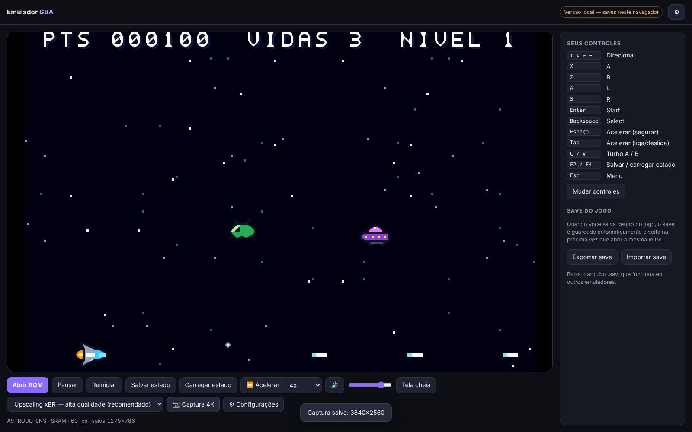
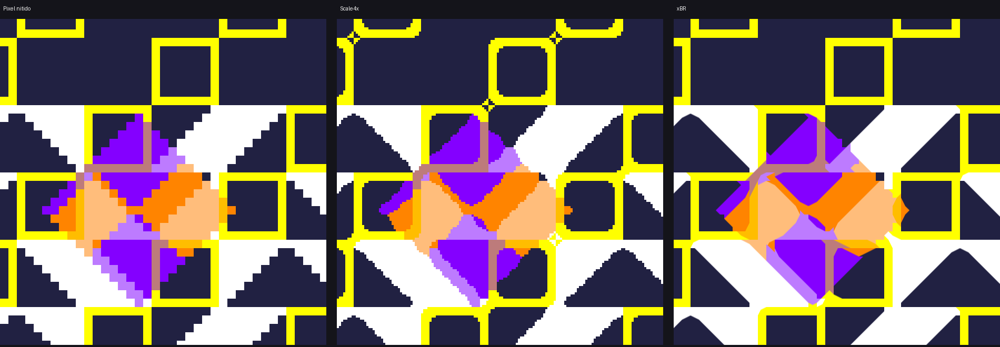
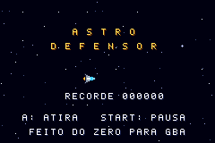
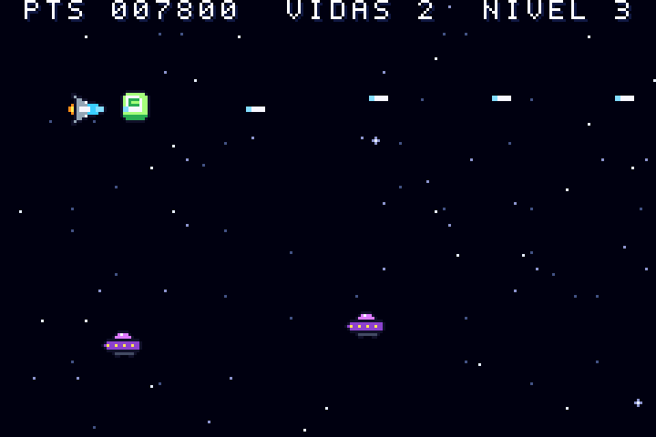
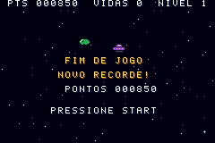
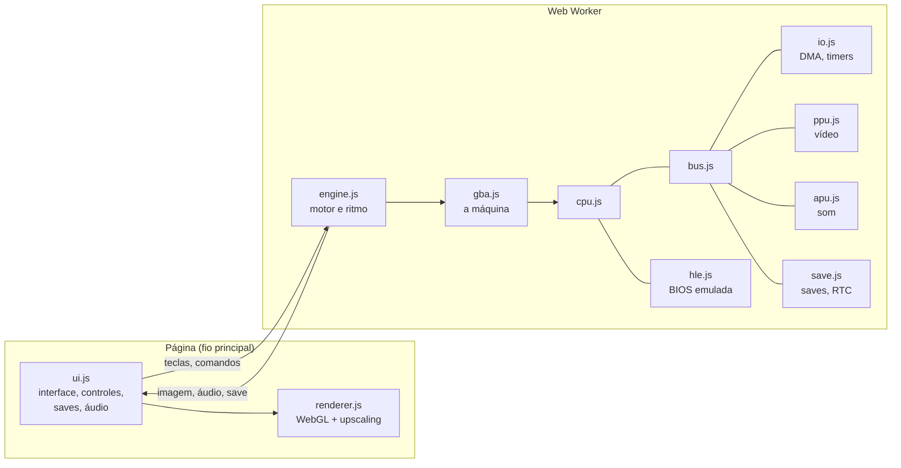

# Emulador GBA

Um emulador de **Game Boy Advance** que roda direto no navegador, escrito do zero em JavaScript, sem nenhuma biblioteca externa. É um único arquivo HTML: abra, carregue a ROM e jogue, no computador ou no celular.

> 🎮 **Jogue agora:** https://enzocoutinh0.github.io/emulador-gba/
>
> *A Game Boy Advance emulator written from scratch in plain JavaScript. Runs in any modern browser, desktop or mobile, from a single HTML file.*



---

## Recursos

- **Emulação completa do hardware:** processador ARM7TDMI (ARM e Thumb), vídeo (modos 0–5, sprites, rotação e zoom, janelas, transparência, mosaico), som (Direct Sound e os 4 canais PSG), DMA, timers e interrupções
- **BIOS emulada:** não precisa da BIOS original da Nintendo (mas aceita, se você tiver a sua)
- **Saves:** SRAM, Flash 64/128 KB e EEPROM, detectados automaticamente e guardados no navegador
- **Relógio (RTC):** usado por Pokémon Ruby, Sapphire e Emerald, sincronizado com a hora do seu computador
- **Contas:** login com senha (protegida com PBKDF2), cada conta com os próprios jogos, saves, estados e controles
- **Biblioteca de jogos:** seus jogos ficam guardados com a imagem do ponto em que você parou, a data e o tempo jogado
- **Continuar de onde parou:** cada jogo grava sozinho o momento exato ao sair, trocar de jogo ou a cada 2 minutos, então dá para alternar entre vários jogos e cada um continua dali
- **Save states:** 4 espaços com miniatura, além do automático
- **Acelerar:** de 2x a 16x, ou na velocidade máxima, com som acelerado contínuo
- **Upscaling opcional:** imagem original (pixels nítidos) ou filtros **xBR**, Scale2x/Scale4x, suave, grade de LCD e TV antiga (CRT), desenhados na resolução real do monitor, até 4K
- **Captura de tela em 4K:** PNG em 3840×2560 com o filtro escolhido
- **Controles personalizáveis:** teclado e gamepad (Xbox, PlayStation, 8BitDo e genéricos), com turbo A/B
- **Celular:** controles virtuais com o aparelho em pé ou deitado, tamanho e opacidade ajustáveis
- **Funciona offline:** um arquivo só, sem instalar nada
- **Abre `.gba` e `.zip`**

## Como usar

1. Abra o emulador (pelo link acima ou dando dois cliques em `index.html`)
2. Crie uma conta (ou jogue como convidado)
3. Clique em **Adicionar jogo** ou arraste um arquivo `.gba` ou `.zip` para a tela
4. Jogue! Para trocar de jogo, volte à **Biblioteca**: cada jogo continua de onde parou

As contas e os jogos ficam guardados no navegador (IndexedDB), separados por conta. Como o emulador não tem servidor, uma conta criada num computador não aparece em outro.

A ROM nunca sai do seu aparelho: nada é enviado para servidor nenhum.

### Controles padrão (teclado)

| Tecla | Ação |
| --- | --- |
| Setas | Direcional |
| `X` | A |
| `Z` | B |
| `A` / `S` | L / R |
| `Enter` | Start |
| `Backspace` | Select |
| `C` / `V` | Turbo A / Turbo B |
| `Espaço` (segurar) | Acelerar |
| `Tab` | Acelerar (liga/desliga) |
| `U` | Liga/desliga o upscaling |
| `F2` / `F4` | Salvar / carregar o estado do espaço 1 |
| `F9` | Captura de tela em 4K |
| `F` | Tela cheia |
| `P` | Pausar |
| `Esc` | Menu rápido |

Tudo pode ser trocado em **⚙ Configurações**.

### Saves

O save do jogo é guardado automaticamente no navegador sempre que você salva dentro do jogo, e volta quando você abre a mesma ROM. Use **Exportar save** para ter uma cópia em `.sav` (compatível com outros emuladores) e **Importar save** para trazer um save de outro lugar.

### Upscaling

A imagem original do GBA tem 240×160 pixels. Você escolhe se quer manter os pixels originais ou usar um dos filtros de upscaling, desenhados pela placa de vídeo na resolução do seu monitor:



*Da esquerda para a direita: original, Scale4x e xBR, numa captura em 4K.*

## Jogo de exemplo: Astro Defensor

Na pasta [`exemplos/astro-defensor`](exemplos/astro-defensor) há um jogo de nave original para GBA, feito do zero em C para este emulador: três tipos de inimigos, power-up, música, efeitos sonoros e recorde salvo no cartucho. A ROM pronta é [`astro-defensor.gba`](exemplos/astro-defensor/astro-defensor.gba).

  

## Como funciona



A emulação roda num **Web Worker**, separada da página. Assim, gravar o save, desenhar a tela ou mexer na interface nunca atrasam o jogo. No modo acelerado, os quadros que não chegariam à tela nem são desenhados, o que dobra a velocidade possível.

| Arquivo | O que faz |
| --- | --- |
| `src/cpu.js` | Processador ARM7TDMI: instruções ARM e Thumb, flags, modos e interrupções |
| `src/bus.js` | Mapa de memória: encaminha cada leitura e escrita para a região certa |
| `src/io.js` | Registradores de controle, 4 canais de DMA e 4 timers |
| `src/hle.js` | BIOS emulada: divisão, descompressão (LZ77, Huffman, RLE), matrizes de rotação etc. |
| `src/ppu.js` | Vídeo: fundos, sprites, janelas e efeitos de cor, linha por linha |
| `src/apu.js` | Som: Direct Sound A/B e os canais de onda quadrada, onda programável e ruído |
| `src/save.js` | Chips de save (SRAM, Flash, EEPROM) e o relógio RTC |
| `src/gba.js` | Junta as peças, roda um quadro e faz os save states |
| `src/engine.js` | Motor que roda no Web Worker e conversa com a página por mensagens |
| `src/renderer.js` | Desenha pela placa de vídeo com os filtros (shaders GLSL) |
| `src/accounts.js` | Contas (senhas com PBKDF2) e armazenamento no IndexedDB |
| `src/ui.js` | Interface: login, biblioteca, configurações, teclado, gamepad, toque, saves e estados |
| `src/template.html` | Layout e visual da página |

O código é todo comentado em português, explicando o que cada parte faz e por quê.

## Compilar

O emulador final é um único HTML montado a partir dos arquivos em `src/`:

```bash
python3 build.py
# gera index.html (o emulador completo num arquivo só)
```

Não há dependências: só Python 3 para juntar os arquivos.

## Publicar no GitHub Pages

O `index.html` na raiz do repositório já é o emulador pronto. Para ele virar um site: **Settings → Pages → Source: Deploy from a branch → Branch: `main` / `(root)`**.

## Testes

O projeto tem ROMs de teste próprias, escritas em C e assembly e compiladas para ARM. Elas conferem o emulador contra resultados conhecidos:

| Teste | O que verifica |
| --- | --- |
| `cputest.c` | Contas, deslocamentos, 64 bits, divisão, memória, structs, recursão e ponteiros de função, comparados com o mesmo programa rodando nativamente, em modo ARM e Thumb |
| `edge.s` | Casos de borda da CPU: flags, RRX, deslocamento por 32, leituras desalinhadas, bancos de registradores, SWP, LDM/STM |
| `systest.c` | Interrupções, VBlankIntrWait, timers (inclusive em cascata), DMA, descompressão LZ77, Div e Sqrt |
| `ppu.c` | Fundos com rolagem e espelhamento, sprites normais e rotacionados, transparência e janelas (gera um PNG) |
| `flash.c` / `eeprom.c` | Chips de save e o relógio RTC |
| `sound.c` | Direct Sound via DMA (frequência do sinal gerado) |
| `heavy.c` | Desempenho num cenário pesado (4 fundos, 128 sprites, CPU ocupada) |

Para rodar, você precisa de `clang`, `ld.lld` e `llvm-objcopy` (para compilar as ROMs) e do Node.js:

```bash
cd test
./build.sh cputest.c thumb rt.s
node run.js build/cputest_thumb.gba 600
```

Os testes de interface (`test/browser*.py`) usam o Playwright com o Chrome.

## Compatibilidade

O emulador foi desenvolvido e validado com as ROMs de teste acima e com o Astro Defensor. A compatibilidade com jogos comerciais ainda está sendo testada.

<!-- Preencha conforme for testando -->
| Jogo | Situação |
| --- | --- |
| *(seu jogo aqui)* | *(funciona / problemas / não inicia)* |

Se algum jogo não funcionar, abra uma *issue* dizendo o jogo, o que aconteceu e em que parte.

### Limitações conhecidas

- Sem cabo de link (troca e batalha entre dois jogos)
- O tempo de acesso à memória é aproximado: jogos que dependem de tempo exato de ciclo podem ter pequenas diferenças
- Sem suporte a acessórios de cartucho (sensor solar do Boktai, sensor de movimento etc.)

## Aviso legal

Este projeto **não inclui** nenhum jogo, ROM ou BIOS da Nintendo, e não tem ligação com a Nintendo. A BIOS foi reimplementada do zero. Use apenas ROMs extraídas dos seus próprios cartuchos.

Game Boy Advance é marca registrada da Nintendo.

## Créditos

Desenvolvido com auxílio de IA (Claude, da Anthropic).

A documentação técnica [GBATEK](https://problemkaputt.de/gbatek.htm), de Martin Korth, é a principal referência sobre o hardware do GBA. O filtro xBR é baseado no algoritmo de Hyllian.

## Licença

[MIT](LICENSE)
