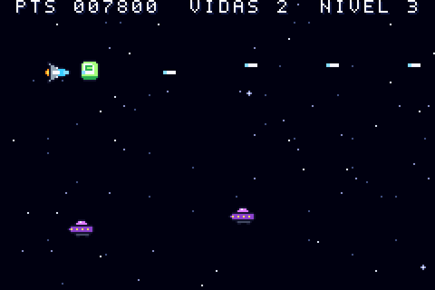

# Astro Defensor

Um jogo de nave para **Game Boy Advance**, feito do zero em C, sem bibliotecas: gráficos, fonte, música e efeitos sonoros são todos originais e gerados por código.



## Como jogar

| Botão | Ação |
| --- | --- |
| Direcional | Mover a nave |
| A | Atirar (segure para tiro contínuo) |
| START | Começar / pausar |

- **Disco roxo** (100 pts): vem reto
- **Inseto verde** (150 pts): voa em onda
- **Torreta vermelha** (300 pts, aguenta 4 tiros): para e atira em você
- **Cápsula verde**: tiro duplo por 10 segundos

A cada nível os inimigos ficam mais rápidos e frequentes. O recorde fica salvo no cartucho (SRAM).

Abra `astro-defensor.gba` em qualquer emulador de GBA, inclusive o [Emulador GBA](../) deste projeto.

## Compilar

Precisa de `python3`, `clang`, `ld.lld` e `llvm-objcopy`:

```bash
./build.sh
# gera build/astro-defensor.gba
```

| Arquivo | O que tem |
| --- | --- |
| `source/main.c` | O jogo: telas, nave, inimigos, colisões, som, recorde |
| `source/gba.h` | Endereços do hardware do GBA |
| `source/irq.s` | Tratador de interrupção (VBlank) |
| `source/crt0.s` / `link.ld` | Inicialização e mapa de memória da ROM |
| `source/libc.c` | Divisão inteira (o processador do GBA não tem) |
| `tools/gfx.py` | Desenha os sprites, a fonte, as estrelas e a música e gera `source/gfx.h` |
| `tools/fixheader.py` | Preenche o cabeçalho da ROM |

Para mudar a arte, edite os desenhos em ASCII no `tools/gfx.py` (cada letra é uma cor) e compile de novo. O script também gera `tools/preview.png` com todos os sprites.

Para rodar num GBA de verdade (flashcart), passe a ROM pelo `gbafix` do devkitPro, que adiciona ao cabeçalho o logotipo exigido pelo console.

## Licença

MIT
